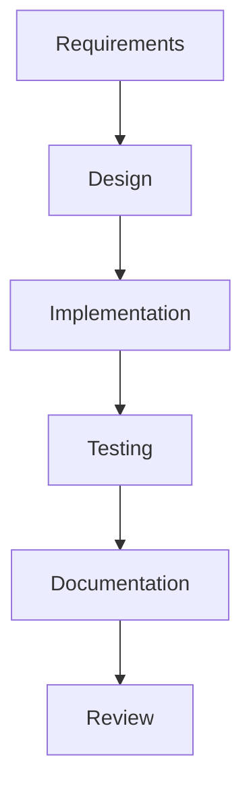
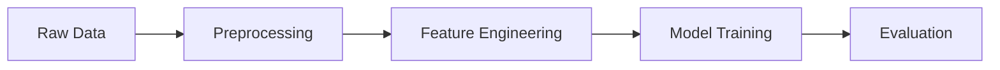

# Legal Text Classification System

## 📁 Vault Structure

```markdown
legal-classification/
├── 🏗️ System Architecture/
│   ├── Overview.md
│   ├── Component Details.md
│   ├── Data Flow.md
│   └── Technical Specs.md
├── 💻 Implementation/
│   ├── Setup Guide.md
│   ├── Dependencies.md
│   ├── Code Structure.md
│   └── Testing Strategy.md
├── 📊 Data/
│   ├── Dataset Analysis.md
│   ├── Preprocessing Steps.md
│   └── Feature Engineering.md
├── 🤖 Models/
│   ├── BERT Implementation.md
│   ├── Rule-Based System.md
│   └── Ensemble Strategy.md
├── 📝 Documentation/
│   ├── API Reference.md
│   ├── User Guide.md
│   └── Maintenance.md
└── 📈 Progress/
    ├── Daily Notes/
    ├── Weekly Reviews/
    └── Milestones.md
```

## 🔗 Key Links and References

```markdown
[[Overview|System Overview]]
[[Component Details|Detailed Architecture]]
[[Setup Guide|Getting Started]]
[[Dataset Analysis|Data Understanding]]
```

## 📋 Templates

### Daily Note Template
```markdown
# Daily Note {{date}}

## Tasks
- [ ] 

## Progress
- 

## Challenges
- 

## Next Steps
- 

## Links
[[Related Notes]]
```

### Component Documentation Template
```markdown
# Component: [Name]

## Purpose
- 

## Technical Specifications
- Input:
- Output:
- Dependencies:
- Performance Requirements:

## Implementation Details
- 

## Testing Strategy
- 

## Related Components
- [[Component 1]]
- [[Component 2]]
```

## 🏷️ Tags System
```markdown
#project/legal-classification
#component/intake
#component/processing
#component/output
#status/in-progress
#status/completed
#priority/high
#priority/medium
#priority/low
```

## 📊 Progress Tracking

### Kanban in Obsidian
```markdown
## Backlog
- [ ] Task 1
- [ ] Task 2

## In Progress
- [ ] Task 3 #priority/high
- [ ] Task 4 #component/intake

## Review
- [ ] Task 5

## Completed
- [x] Task 6
```

## 🔄 Workflows

### Development Workflow


### Data Processing Workflow


## 📑 Code Documentation Example

```python
"""
# Document Processor
[[Component Details#Document Processor|Documentation]]

## Usage
```python
processor = DocumentProcessor()
result = processor.process_document(text)
```

## Integration Points
- [[Feature Engineering]]
- [[Model Training]]
"""
```

## 🔍 Query Examples

```dataview
TABLE file.mtime as "Last Modified"
FROM #component/intake
SORT file.mtime DESC
```

## 📌 Important Notes

1. Use `[[Links]]` for component connections
2. Keep daily notes in the Daily Notes folder
3. Tag all implementation details with appropriate component tags
4. Use mermaid diagrams for visual documentation
5. Link code documentation to component details

## 🚀 Getting Started

1. Clone this vault structure
2. Install recommended plugins:
   - Dataview
   - Calendar
   - Kanban
   - Mermaid
3. Start with [[Overview]] note
4. Follow setup in [[Setup Guide]]