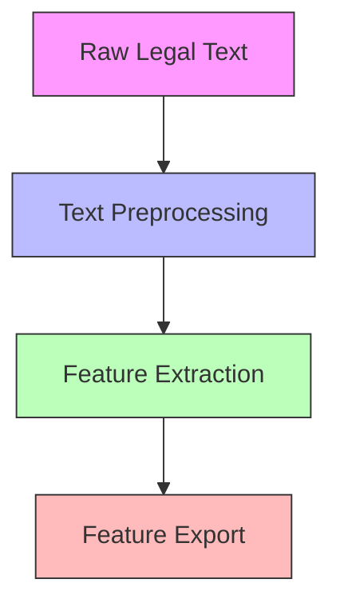

# CLD6000 Technical Foundation
*Version: 1.0.0 | Updated: 2024-11-25*

## 🎯 NLP Focus Areas
```python
def nlp_focus_strategy():
    """
    Strategic approach for NLP components
    No classification implementation
    """
    return {
        'text_processing': {
            'preprocessing': ['cleaning', 'normalization', 'tokenization'],
            'feature_extraction': ['entity_recognition', 'pattern_detection'],
            'pipeline_optimization': ['memory_efficiency', 'parallel_processing']
        },
        'prohibited_areas': ['classification', 'model_selection', 'training']
    }
```

## 🔄 Development Workflow



## 📊 Analysis Framework

### Text Processing Strategy
```python
processing_strategy = {
    'document_segmentation': {
        'method': 'structural_analysis',
        'components': ['paragraphs', 'sections', 'citations'],
        'metrics': ['accuracy', 'efficiency']
    },
    'feature_generation': {
        'approach': 'hierarchical_processing',
        'outputs': ['statistical_features', 'linguistic_markers']
    }
}
```

## 🛠️ Technical Implementation

### Pipeline Architecture
```yaml
pipeline_components:
  text_processor:
    input: raw_legal_documents
    stages:
      - cleaning
      - normalization
      - feature_extraction
    output: processed_features
    
  feature_engineering:
    input: processed_text
    operations:
      - statistical_analysis
      - pattern_recognition
      - entity_extraction
    output: feature_vectors
```

## 📈 Performance Metrics

### Evaluation Framework
```python
evaluation_metrics = {
    'processing_speed': 'documents_per_second',
    'memory_usage': 'peak_memory_mb',
    'feature_quality': {
        'completeness': 'percentage',
        'accuracy': 'error_rate'
    }
}
```

## 🔍 Weekly Progress Framework

### Week Structure
```markdown
Week [N]:
- 📝 Completed Components
- 🧪 Experiments Conducted
- 📊 Performance Results
- 🔄 Optimization Steps
```

## 🔗 Integration Points

### Data Handoff
```python
feature_export_spec = {
    'format': 'parquet',
    'schema': {
        'features': 'vector',
        'metadata': 'json',
        'timestamps': 'datetime64'
    },
    'validation': ['completeness', 'consistency']
}
```

## ⚠️ Important Notes
1. No classification implementation
2. Focus on feature quality
3. Efficient resource usage
4. Clear documentation
